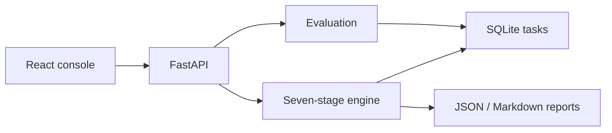
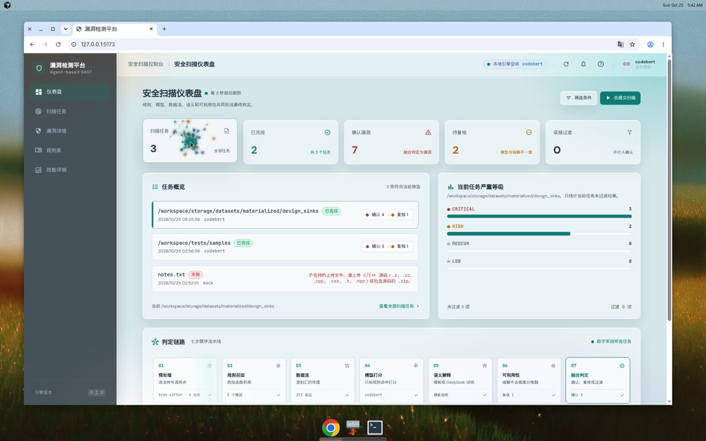
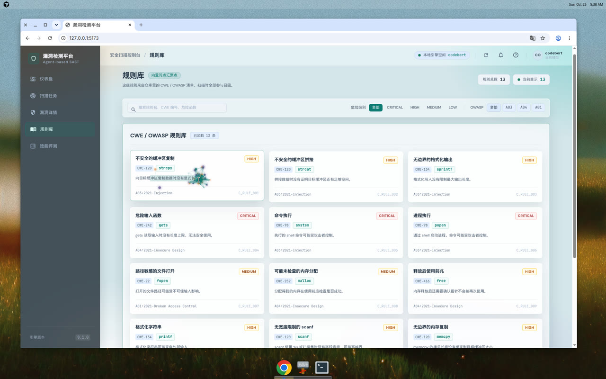
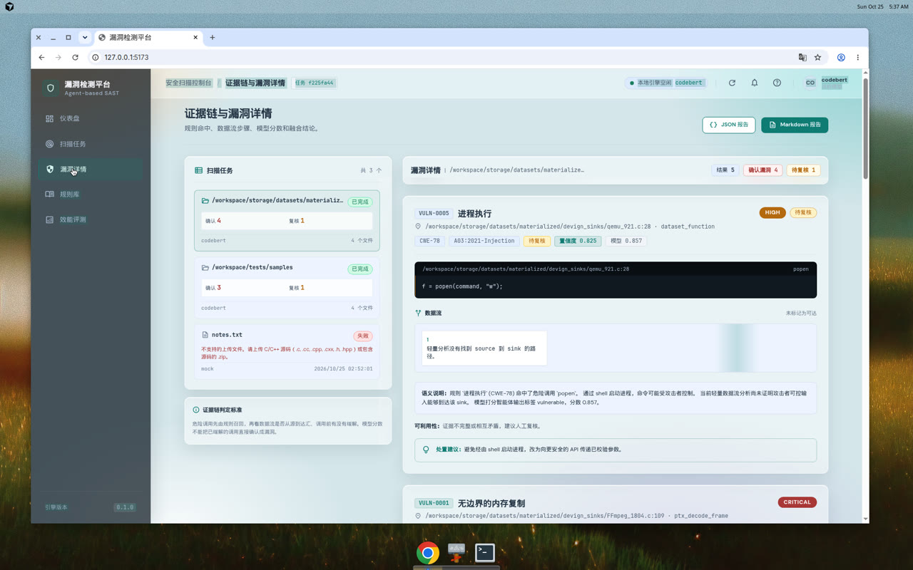
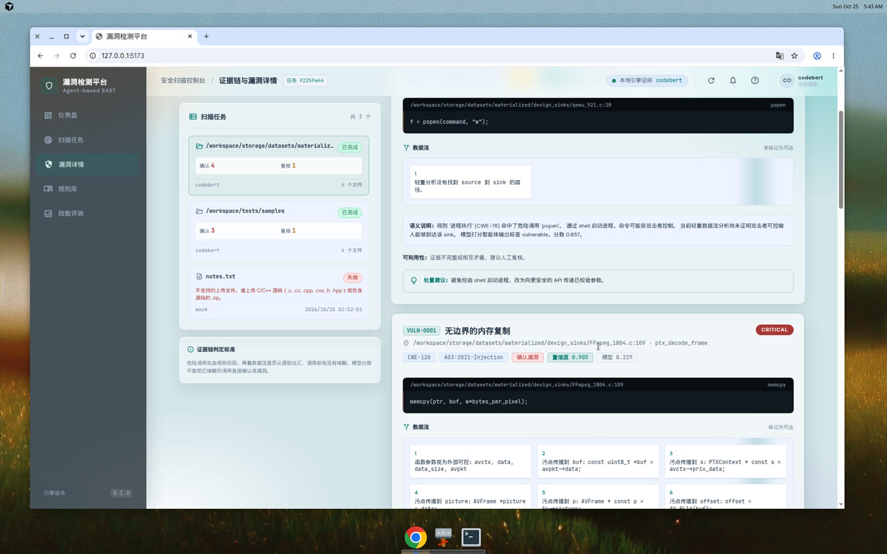
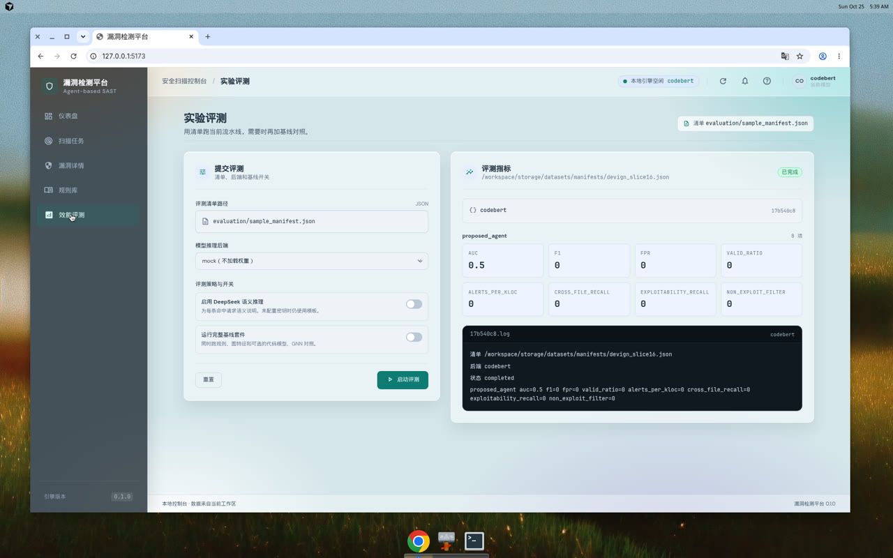

<p align="center">
  <a href="README.md">中文</a> · <a href="README.en.md"><b>English</b></a>
</p>

<h1 align="center">🔍 Agent Vulnerability Detection — Fusion Guard</h1>

<p align="center">
  
  
  
  
  
  
</p>

<p align="center"><b>A C/C++ vulnerability console built from rules, data flow, and CodeBERT</b></p>

<p align="center"><i>Seven ordered stages · Local mitigations survive high model scores · Frosted cards with hover particles · Measured on a small Devign slice</i></p>

<p align="center">
  <a href="#architecture">📐 Architecture</a>
  ·
  <a href="#quick-start">🚀 Quick start</a>
  ·
  <a href="#results">📊 Results</a>
  ·
  <a href="#interface">🧊 Interface</a>
</p>

The project follows the idea in *Research on an Agent-Based Code Vulnerability Detection Framework*. It does not treat detection as one classifier. Rules, data flow, a code model, a written explanation, an exploitability check, and a fusion decision run in a fixed order and leave one evidence chain. The maintainer is [jdytwagn](https://github.com/jdytwagn).

## Architecture

There are four layers. The React console reads only the tasks stored for the current workspace. FastAPI owns tasks, uploads, and reports. The engine runs seven agents in order. The evaluation layer compares that pipeline with model baselines on the same manifest.



The default chain is a sequence, not a free-form debate:

```text
source → preprocess → rules → data flow → model score → explanation → exploitability → fusion
```

| Step | Agent | Role |
| --- | --- | --- |
| 01 | Preprocess | Tree-sitter functions, calls, a lightweight CFG/DFG, and source/sink nodes |
| 02 | Rules | CWE/OWASP hits become candidates. The model cannot invent one |
| 03 | Data flow | Trace source to sink on function text and call edges |
| 04 | Model score | Score only those hits. Backends: mock, CodeBERT, GraphCodeBERT |
| 05 | Explanation | Chinese write-up. A template is used when DeepSeek is not configured |
| 06 | Exploitability | Input control, path evidence, and local mitigation |
| 07 | Fusion | Combine the evidence. A high model score cannot overrule a local mitigation |

The guard lives in `agents/fusion_agent.py`. When a bounds check, validation, or safer API is present, exploitability stays `not_exploitable`. A model score of at least 0.65 then becomes `needs_review`. A lower score becomes `filtered_false_positive`. Incomplete evidence also stays in review.

## Approach

Detection is split into who may become a candidate, and whether that candidate can be confirmed.

The rule pack recalls dangerous sinks such as `memcpy`, `popen`, and `free`. Data flow asks whether taint reaches the sink. The code model assigns a score from 0 to 1 only to functions the rules already recalled. The semantic stage turns the evidence into a readable note. Exploitability can reject a hit that is already mitigated locally. Fusion then emits `vulnerable`, `needs_review`, or a filtered result, and the console counts them separately.

An alert can be walked back to a rule, a path, and a score. The cost is explicit: a vulnerability the rules never recall is invisible to the model. That miss shows up directly as F1 on a random slice, and the measurement below keeps it.

## Design

- Evidence outranks a lone score. The model moves confidence. It does not overrule a local mitigation by itself.
- Review is a result. A missing path or conflicting evidence stops for a person.
- The console is bound to the current SQLite tasks. Counts and metrics come from the run. Cluster status, people, and GPU claims are not invented.
- Mineral teal `#0E7C73` sits on a dusk mesh `#D5E6EA`. Facts live on frosted cards. Motion starts only while the pointer is on a card.

## Interface

The page background is `#D5E6EA` plus peach, teal, and lilac radial gradients, so a translucent card still shows the room behind it. Primary is `#0E7C73`, the dim step is `#0A5E57`, and the container tint is `#D7F4EF`.

Module cards, rule cards, and raised cards use white at about 48% opacity, an 18px backdrop blur, and an inner highlight. Hover lifts a card by 4px, raises the white to about 66%, and adds a teal edge. The sidebar is dark glass, `rgba(14, 24, 32, 0.72)`, blurred by 22px. Those rules are in `frontend/src/styles/app.css`, after the Tailwind utilities, so a solid surface color does not paint over the glass.

`frontend/src/components/ParticleField.tsx` draws on a viewport canvas that ignores pointer events. Once the pointer enters `.console-card`, `.card-elevation`, or `.rule-card`, it spawns teal, sand, lilac, and near-white dots. Dots closer than 42px are linked. A stationary pointer keeps spawning every 70ms. At most 70 dots are kept, and drawing is clipped to that card. Reduced-motion preference skips the field and the lift.

<p align="center">
  
</p>

<p align="center"><i>Dashboard. The pointer rests on Scan Tasks, and the particles stay inside that card.</i></p>

<p align="center">
  
</p>

<p align="center"><i>Rule library. The same glass and particles are used on the CWE cards.</i></p>

## Results

Both measurements are from one local session on 2026-10-25. The backend was CodeBERT in strict mode, `model_fallback` was false, and DeepSeek was not called. The machine was CPU-only: PyTorch 2.14.1 and `torch.cuda.is_available()` was false. The raw CSV and the weights stay under `storage/` and are not in the repository.

### Four Devign functions that contain dangerous sinks

Four functions labeled vulnerable were taken from the Devign C test CSV `data_C_Devign_test.csv`: QEMU samples 248, 304, and 921, plus FFmpeg sample 1804. They were scanned with strict CodeBERT. Task `f225fa44-fcd4-43ee-a935-b76c177e0dfe` finished in about eight seconds.

| Item | Result |
| --- | --- |
| Files / functions / call sites | 4 / 5 / 42 |
| Candidates | 5 |
| Confirmed / review / filtered | 4 / 1 / 0 |
| Parser | tree-sitter, no fallback |
| Data-flow edges | 251 |
| Chain | all seven stages, preprocess through fusion |

| ID | Location | Sink | CWE | Model | Confidence | Decision |
| --- | --- | --- | --- | --- | --- | --- |
| VULN-0001 | `FFmpeg_1804.c:109` `ptx_decode_frame` | memcpy | CWE-120 | 0.229 | 0.905 | confirmed, critical |
| VULN-0002 | `qemu_248.c:29` `usbredir_bulk_packet` | free | CWE-416 | 0.943 | 0.990 | confirmed, critical |
| VULN-0003 | `qemu_248.c:59` `usbredir_bulk_packet` | memcpy | CWE-120 | 0.523 | 0.990 | confirmed, critical |
| VULN-0004 | `qemu_304.c:29` `header_ext_add` | memcpy | CWE-120 | 0.067 | 0.848 | confirmed, high |
| VULN-0005 | `qemu_921.c:28` `dataset_function` | popen | CWE-78 | 0.857 | 0.825 | review, high |

`popen` scored 0.857, but the lightweight data flow found no source-to-sink path and exploitability stayed `uncertain`, so fusion left it in review. The FFmpeg `memcpy` scored only 0.229, the taint steps were present, and exploitability was `exploitable`, so it was confirmed. A high score does not convict by itself, and a low score does not erase a connected dangerous sink.

<p align="center">
  
</p>

<p align="center"><i>popen in qemu_921.c. Model score 0.857, decision still needs review.</i></p>

<p align="center">
  
</p>

<p align="center"><i>memcpy in FFmpeg_1804.c. Model score 0.229, evidence was enough to confirm.</i></p>

The dashboard in the screenshot is the local workspace, not a public leaderboard: 3 scan tasks, 2 completed, 7 confirmed, 2 in review, 0 filtered. That total includes this Devign scan, an earlier `tests/samples` scan, and one failed `notes.txt` upload. The file was not C/C++ source or a zip, and the console kept that error.

### Sixteen-function balanced slice

A second draw from the same CSV has 16 functions, 8 vulnerable and 8 benign: 13 from QEMU and 3 from FFmpeg. Agent evaluation `17b540c8-4fcc-4c59-a03d-ab10f93ae5da` reported:

| Metric | Agent pipeline |
| --- | --- |
| Samples | 16 |
| AUC | 0.5 |
| F1 | 0 |
| FPR | 0 |
| Alerts/KLOC | 0 |

The rules matched none of the 16 functions, so the pipeline raised no alerts. The model only scores rule hits and never got a chance to label these functions. AUC 0.5 and F1 0 are the measured slice, not a paper baseline.

<p align="center">
  
</p>

A pure CodeBERT baseline on the same manifest does not wait for a rule hit. The calibration split has 4 samples, the evaluation split has 12, the seed is 7, and the splits do not overlap. The calibrated threshold was 0.0.

| Metric | CodeBERT baseline |
| --- | --- |
| Samples | 12 |
| AUC | 0.8333 |
| F1 | 0.6667 |
| FPR | 1.0 |
| Alerts/KLOC | 47.4308 |
| Valid Ratio | 0.5 |
| Threshold | 0.0 |

With threshold 0.0 and the rule `score >= threshold`, every evaluation sample falls on the positive side, so FPR is 1.0. This is a 16-function slice. It is not a full Devign paper number. A report JSON also carries document constants marked `measured: false`; those constants are not used here.

## Quick start

Python 3.10 or newer. The base install runs rules, Tree-sitter, data flow, reports, the CLI, and the API without model weights.

```bash
python3 -m venv .venv
source .venv/bin/activate
python -m pip install -e ".[test]"
python main.py scan tests/samples --output out/report.json --markdown out/report.md
```

Install `.[model,test]` when you need CodeBERT, GraphCodeBERT, or the GNN baseline. For the console:

```bash
cd frontend && npm ci && npm run dev
```

Run `python -m backend.run` in another terminal. The console is `http://127.0.0.1:5173`. Health is `http://127.0.0.1:8000/api/health`.

What the repository actually implements:

- CLI commands `scan`, `evaluate`, `evaluate-baseline`, `evaluate-suite`, `prepare-dataset`, and `migrate-db`.
- Scans `.c`, `.cc`, `.cpp`, `.cxx`, `.h`, and `.hpp`. The UI also accepts those suffixes and `.zip`.
- The seven-agent order is configurable.
- Reports are written as JSON and Markdown.
- Model backends are mock, CodeBERT, and GraphCodeBERT, with a strict mode.
- Semantic text falls back to a template when DeepSeek is missing or fails.
- Dataset adapters cover Juliet, Devign, and Big-Vul manifests.
- Scan and evaluation tasks are stored in SQLite.

Commands, the API, configuration, and Docker are in [docs/usage.md](docs/usage.md). The longer operational page is written in Chinese.

## Limits

The lightweight CFG/DFG feeds features and the report. It is not a Clang/LLVM reachability proof. Function parameters stay tainted. Without local mitigation evidence, fusion can still confirm a dangerous sink. Authentication, a job queue, and resource isolation are still open; see [docs/production_readiness.md](docs/production_readiness.md).

## Docs

- [Usage](docs/usage.md) (Chinese)
- [Beginner guide](docs/beginner_guide.md) (Chinese)
- [Architecture](docs/architecture.md) (Chinese)
- [API](docs/api.md)
- [Models](docs/models.md)
- [Datasets](docs/datasets.md)
- [Evaluation](docs/evaluation.md)
- [Deployment](docs/deployment.md)

## License

[MIT License](LICENSE).
