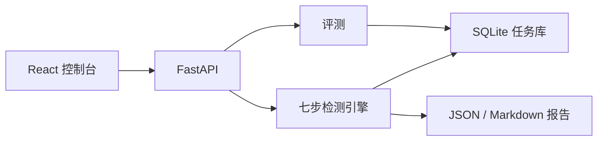

<p align="center">
  <a href="README.md"><b>中文</b></a> · <a href="README.en.md">English</a>
</p>

<h1 align="center">🔍 Agent Vulnerability Detection — Fusion Guard</h1>

<p align="center">
  
  
  
  
  
  
</p>

<p align="center"><b>基于规则、数据流与 CodeBERT 的 C/C++ 漏洞检测控制台</b></p>

<p align="center"><i>七步顺序判定 · 局部缓解不被模型分覆盖 · 白底叠卡与淡蓝光标环 · Devign 小样本实测</i></p>

<p align="center">
  <a href="#设计架构">📐 设计架构</a>
  ·
  <a href="#快速开始">🚀 快速开始</a>
  ·
  <a href="#实验结果">📊 实验结果</a>
  ·
  <a href="#界面实现">🧊 界面实现</a>
</p>

项目实现思路来自《基于智能体的代码漏洞检测框架研究》。它不把漏洞检测做成单个分类器，而是让规则、数据流、代码模型、语义说明、可利用性验证和融合决策按固定顺序交出同一条证据链。维护者是 [jdytwagn](https://github.com/jdytwagn)。

## 设计架构

系统分成四层。React 控制台只读当前工作区里的真实任务；FastAPI 负责任务、上传和报告；检测引擎按顺序跑七个智能体；评测层用同一份 manifest 比较智能体流水线和模型基线。



默认链路是一条顺序流水线，不是互相辩论的自由多智能体：

```text
源码 → 预处理 → 规则召回 → 数据流 → 模型打分 → 语义解释 → 可利用性 → 融合判定
```

| 步骤 | 智能体 | 做什么 |
| --- | --- | --- |
| 01 | 预处理 | Tree-sitter 提取函数、调用、轻量 CFG/DFG、source/sink |
| 02 | 规则召回 | 用 CWE/OWASP 规则产生候选，模型不能自己发明候选 |
| 03 | 数据流 | 在函数文本和调用边上追踪 source 到 sink |
| 04 | 模型打分 | 只给规则命中打分，后端为 mock、CodeBERT 或 GraphCodeBERT |
| 05 | 语义解释 | 生成中文说明；未配置 DeepSeek 时使用模板 |
| 06 | 可利用性 | 看输入是否可控、路径是否连通、局部是否已有缓解 |
| 07 | 融合判定 | 汇总证据。局部缓解不会被高模型分改判成漏洞 |

融合规则写在 `agents/fusion_agent.py`。已经看到边界检查、校验或更安全接口时，可利用性保持 `not_exploitable`。此时模型分达到 0.65 只进入 `needs_review`，低于 0.65 记为 `filtered_false_positive`。证据不完整时同样进入复核，而不是直接确认。

## 整体思路

检测分成“谁有资格成为候选”和“这条候选能不能确认”两件事。

规则库先召回危险汇，例如 `memcpy`、`popen`、`free`。数据流再看污点有没有到这个汇。代码模型只给这些已经召回的函数打一个 0 到 1 的分，不能在规则沉默时凭空报警。语义层把证据写成可读说明。可利用性层负责否决已经被局部缓解的命中。融合层最后给出 `vulnerable`、`needs_review` 或过滤结果，并分开计数。

这样做是为了让一次告警能够回到规则、路径和模型分，而不是只剩一个概率。代价也很明确：规则没召回的漏洞，后面的模型看不到。随机函数上的漏报会直接体现在 F1 上，下面的实测保留了这个结果。

## 设计思想

- 证据优先于分数。模型分参与置信度，但不能单方面覆盖局部缓解。
- 复核是一种结果，不是失败状态。路径不完整或证据互相矛盾时停在人工复核。
- 控制台绑定当前 SQLite 任务。扫描数、确认数和评测指标都来自这次运行，不写死集群、人员和 GPU。
- 界面是白底亮色。导航、顶栏、指标、任务和链路各自是一层白色卡片。鼠标到达后，指针周围才出现一圈淡蓝小颗粒。

## 界面实现

控制台是白底。页面底色 `#F4F7FB`，导航、顶栏、指标、任务概览、严重等级和七步链路都是分开的白卡片。指标卡和规则卡再抬高一层，顶边有一条淡蓝高光，数字落在浅灰下凹槽里。当前导航项用 `#4C8DFF` 描边。样式在 `frontend/src/styles/app.css`。

粒子在 `frontend/src/components/CursorRingField.tsx`。画布不接收指针，平时是透明的。鼠标进入页面后，指针周围才画出三圈淡蓝小胶囊，颜色在 `#5B9CFF` 和 `#BAD6FF` 之间。胶囊朝向环心，并沿径向轻轻推开，位移每帧保留 80%。鼠标离开后环消失。

<p align="center">
  
</p>

<p align="center"><i>仪表盘。指针停在“扫描任务”上，淡蓝小颗粒只出现在鼠标周围。</i></p>

<p align="center">
  
</p>

<p align="center"><i>规则库。每条 CWE 规则是一张独立的抬升卡。</i></p>

## 实验结果

下面两组数都来自 2026-10-25 的同一次本地运行。模型是已加载的 CodeBERT，严格模式，`model_fallback` 为 false，语义层没有调用 DeepSeek。环境是 CPU，PyTorch 2.14.1，`torch.cuda.is_available()` 为 false。原始 CSV 和权重在 `storage/`，不进入仓库。

### 含危险汇的四条 Devign 函数

从 Devign 的 C 语言测试 CSV `data_C_Devign_test.csv` 中取出 4 个标签为漏洞的函数，分别来自 QEMU（248、304、921）和 FFmpeg（1804），放到目录里用 CodeBERT 严格模式扫描。任务 `f225fa44-fcd4-43ee-a935-b76c177e0dfe` 约 8 秒完成。

| 项目 | 结果 |
| --- | --- |
| 文件 / 函数 / 调用点 | 4 / 5 / 42 |
| 候选 | 5 |
| 确认 / 复核 / 过滤 | 4 / 1 / 0 |
| 解析器 | tree-sitter，没有回退 |
| 数据流边 | 251 |
| 执行链 | 预处理到融合判定，七步都跑了 |

| 编号 | 位置 | 汇 | CWE | 模型分 | 置信度 | 判定 |
| --- | --- | --- | --- | --- | --- | --- |
| VULN-0001 | `FFmpeg_1804.c:109` `ptx_decode_frame` | memcpy | CWE-120 | 0.229 | 0.905 | 确认，critical |
| VULN-0002 | `qemu_248.c:29` `usbredir_bulk_packet` | free | CWE-416 | 0.943 | 0.990 | 确认，critical |
| VULN-0003 | `qemu_248.c:59` `usbredir_bulk_packet` | memcpy | CWE-120 | 0.523 | 0.990 | 确认，critical |
| VULN-0004 | `qemu_304.c:29` `header_ext_add` | memcpy | CWE-120 | 0.067 | 0.848 | 确认，high |
| VULN-0005 | `qemu_921.c:28` `dataset_function` | popen | CWE-78 | 0.857 | 0.825 | 复核，high |

`popen` 的模型分是 0.857，但轻量数据流没有找到 source 到 sink 的路径，可利用性为 `uncertain`，所以融合结果停在复核。FFmpeg 的 `memcpy` 模型分只有 0.229，数据流能指出污点步，可利用性为 `exploitable`，因此仍然确认。这就是“高分不能单独定罪，低分也不能单独洗掉已连通的危险汇”。

<p align="center">
  
</p>

<p align="center"><i>qemu_921.c 的 popen。模型分 0.857，判定仍是待复核。</i></p>

<p align="center">
  
</p>

<p align="center"><i>FFmpeg_1804.c 的 memcpy。模型分 0.229，证据链足够，判定为确认。</i></p>

截图当时的控制台累计的是本机工作区，不是一套公开排行榜：扫描任务 3，已完成 2，确认漏洞 7，待复核 2，误报过滤 0。其中包含上面这次 Devign 扫描、更早的 `tests/samples` 扫描，以及一次 `notes.txt` 上传失败。失败原因是文件不是 C/C++ 源码或 zip，页面上保留了这句错误。

### 十六条均衡切片

另一组从同一份 CSV 抽出 16 个函数，漏洞和正常各 8 个，项目为 QEMU 13 个、FFmpeg 3 个。智能体评测任务 `17b540c8-4fcc-4c59-a03d-ab10f93ae5da` 的结果是：

| 指标 | 智能体流水线 |
| --- | --- |
| 样本 | 16 |
| AUC | 0.5 |
| F1 | 0 |
| FPR | 0 |
| Alerts/KLOC | 0 |

规则没有命中这 16 个函数，流水线因此没有告警。模型只给规则命中打分，所以它没有机会把这些函数补成漏洞。AUC 0.5 和 F1 0 是这次切片的真实结果，不是纸面基线。

<p align="center">
  
</p>

同一 manifest 上另跑的纯 CodeBERT 基线不经过规则召回。校准集 4 条、评估集 12 条，划分种子 7，两组没有重叠。校准阈值是 0.0。评估集结果：

| 指标 | CodeBERT 基线 |
| --- | --- |
| 样本 | 12 |
| AUC | 0.8333 |
| F1 | 0.6667 |
| FPR | 1.0 |
| Alerts/KLOC | 47.4308 |
| Valid Ratio | 0.5 |
| 阈值 | 0.0 |

阈值 0.0 再按 `score >= threshold` 判定，评估样本全部落在正例一侧，所以 FPR 是 1.0。这是 16 条切片上的小样本结果，不能当成 Devign 全量论文数字。报告 JSON 里另有一份 `measured: false` 的文档常数，本页不引用那些数。

## 快速开始

Python 3.10 以上。基础安装可以跑规则、Tree-sitter、数据流、报告、CLI 和后端，不必先下载模型权重。

```bash
python3 -m venv .venv
source .venv/bin/activate
python -m pip install -e ".[test]"
python main.py scan tests/samples --output out/report.json --markdown out/report.md
```

需要 CodeBERT、GraphCodeBERT 或 GNN 基线时再安装 `.[model,test]`。前端：

```bash
cd frontend && npm ci && npm run dev
```

另一个终端运行 `python -m backend.run`。控制台在 `http://127.0.0.1:5173`，健康检查在 `http://127.0.0.1:8000/api/health`。

当前能力与代码的对应关系：

- CLI 提供 `scan`、`evaluate`、`evaluate-baseline`、`evaluate-suite`、`prepare-dataset`、`migrate-db`。
- 扫描 `.c`、`.cc`、`.cpp`、`.cxx`、`.h`、`.hpp`；前端也可上传这些后缀和 `.zip`。
- 七个智能体的顺序可以配置。
- 报告同时有 JSON 和 Markdown。
- 模型后端是 mock、CodeBERT、GraphCodeBERT，支持严格模式。
- DeepSeek 未配置或调用失败时，语义说明回退到模板。
- 数据集适配器覆盖 Juliet、Devign 和 Big-Vul manifest。
- 扫描和评测任务保存在 SQLite。

命令、接口、配置和 Docker 见 [docs/usage.md](docs/usage.md)。

## 当前边界

轻量 CFG/DFG 用来做特征和报告，不等同于 Clang/LLVM 可达性证明。函数参数默认按污点处理。没有本地缓解证据时，融合仍可能把危险汇确认下来。生产环境还缺认证、队列和资源隔离，见 [docs/production_readiness.md](docs/production_readiness.md)。

## 文档

- [使用说明](docs/usage.md)
- [小白使用和设计说明](docs/beginner_guide.md)
- [系统架构说明](docs/architecture.md)
- [后端接口](docs/api.md)
- [模型接入](docs/models.md)
- [数据集](docs/datasets.md)
- [评测](docs/evaluation.md)
- [部署](docs/deployment.md)

## License

本项目采用 [MIT License](LICENSE)。
