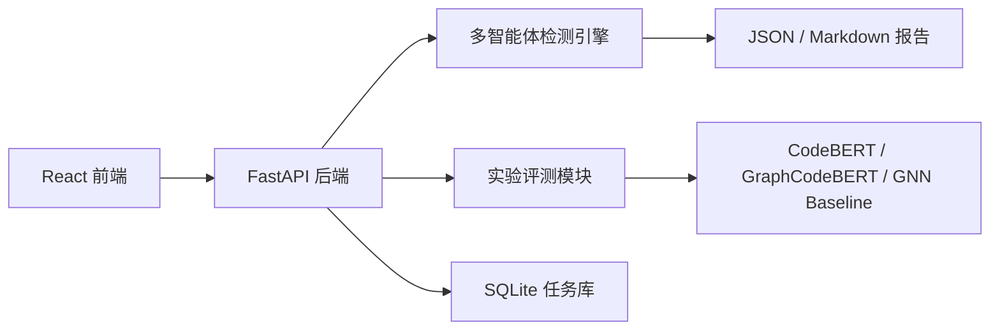

# 系统架构说明

## 四层架构

## 多智能体检测流程

## 当前实现边界

- 预处理智能体默认使用 Tree-sitter C++ 提取函数、参数和调用，并生成 AST 摘要、调用边、变量引用和 source/sink 节点；如果本地缺少 Tree-sitter 语言包，会自动退回轻量解析器。
- 模型打分智能体支持 `mock`、`codebert`、`graphcodebert` 三类后端；本机已缓存 CodeBERT / GraphCodeBERT Devign 微调模型，路径见 `docs/models.md`。
- 语义推理智能体支持 DeepSeek API，可通过 `.env` 和 `--enable-llm-semantics` 打开；未配置或调用失败时自动使用模板解释。
- 预处理层已输出基础 CFG 节点/边和 DFG 边，用于报告统计、图特征 baseline 和后续 GNN 接入；当前仍属于轻量级 CFG/DFG，不等同于 Clang/LLVM 级精确分析。数据流判定仍基于函数文本和调用边，不会把 CFG 当成可达性证明。
- 融合决策不让模型分数单独覆盖局部缓解。已经观察到边界检查、校验或更安全接口时，可利用性保持 `not_exploitable`。模型分数达到 0.65 只把该候选标为 `needs_review`，不能标为 `vulnerable`。模型分数不足 0.65 时记为 `filtered_false_positive`。没有跑可利用性验证、原因仍为空的短链路，继续按分数给出判定。
- 评测模块支持本地 manifest，可逐步接入 Juliet、Devign、Big-Vul 子集，并支持完整评测套件：多智能体框架、CodeBERT、GraphCodeBERT、图特征 baseline、轻量 GNN baseline。
- FastAPI 路径扫描默认限制在项目工作区内；上传压缩包会拒绝路径穿越条目，避免 Zip Slip。
- FastAPI 评测 manifest 和数据集准备的输入/输出路径默认限制在项目工作区内；CORS 默认仅开放本地前端地址，生产环境可通过 `AGENT_DETECTOR_CORS_ORIGINS` 显式配置。
