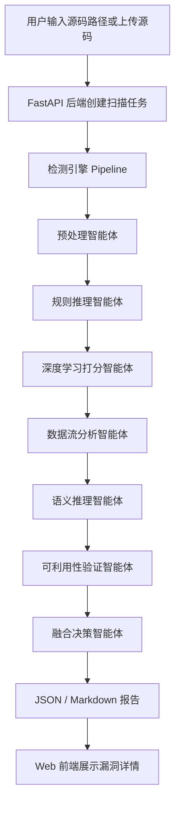

# 小白使用和设计说明

本文档面向第一次接触本项目的同学。目标是让你知道：这个系统是什么、为什么这样设计、代码由哪些部分组成、前端页面展示什么、如何一步步运行和演示。

## 一、项目一句话说明

本项目是一个面向 C/C++ 源码的多智能体代码漏洞检测平台。

它不是只用一个深度学习模型判断“有漏洞/没漏洞”，而是把漏洞检测拆成多个智能体协作完成：

```text
源码输入 -> 代码预处理 -> 规则初筛 -> 模型打分 -> 数据流验证
-> 语义推理 -> 可利用性判断 -> 融合决策 -> 输出漏洞报告
```

最终系统可以通过三种方式使用：

- 命令行：适合开发和测试。
- 后端 API：适合被前端或其他系统调用。
- Web 前端：适合演示、答辩和可视化查看报告。

## 二、为什么要做“多智能体”

传统漏洞检测经常有两个问题：

- 只靠规则：容易发现危险函数，但误报较多，不知道输入是否真的能流到危险函数。
- 只靠模型：能给出概率，但解释性弱，很难说明“为什么这里危险”。

本项目的思路是让不同智能体各做一件事：

- 规则智能体负责快速找到可疑位置。
- 模型智能体负责给候选代码片段打概率分。
- 数据流智能体负责判断外部输入是否能流向危险 API。
- 语义智能体负责生成自然语言解释。
- 可利用性智能体负责判断是否存在过滤、长度检查、白名单等缓解逻辑。
- 融合智能体负责把所有证据合并为最终风险结论。

这样输出的报告不仅有“结果”，还有“证据链”。

## 三、总体架构



项目分为四层：

| 层级 | 目录 | 作用 |
| --- | --- | --- |
| 检测引擎层 | `agents/`、`core/`、`rules/`、`models/`、`reports/` | 真正执行漏洞检测 |
| 后端服务层 | `backend/` | 提供扫描、评测、规则、报告 API |
| 前端展示层 | `frontend/` | 提供可视化页面 |
| 实验评测层 | `evaluation/` | 支持数据集评测和模型 baseline 对比 |

## 四、目录怎么看

```text
agent-vuln-detector/
  agents/          七个智能体的实现
  backend/         FastAPI 后端服务
  core/            核心数据结构、扫描器、流水线配置
  docs/            中文说明文档
  evaluation/      数据集评测、指标计算、baseline
  frontend/        React + TypeScript 前端
  models/          mock、CodeBERT、GraphCodeBERT、DeepSeek 接口
  reports/         JSON 和 Markdown 报告生成
  rules/           CWE/OWASP 规则库
  scripts/         一键启动脚本
  storage/         SQLite、上传文件、报告、数据集和模型
  tests/           测试用例和示例 C/C++ 代码
  main.py          命令行入口
```

你可以先重点看这些文件：

| 文件 | 为什么重要 |
| --- | --- |
| `main.py` | 命令行入口，所有 CLI 命令都从这里进 |
| `core/pipeline.py` | 七个智能体的执行顺序 |
| `core/types.py` | 系统内部统一数据结构 |
| `agents/*.py` | 每个智能体的具体逻辑 |
| `rules/cwe_rules.yaml` | 当前规则库 |
| `backend/api/app.py` | 后端 API 路由 |
| `frontend/src/main.tsx` | 前端页面主体 |

## 五、七个智能体分别做什么

| 智能体 | 文件 | 输入 | 输出 | 作用 |
| --- | --- | --- | --- | --- |
| 预处理智能体 | `agents/preprocess_agent.py` | C/C++ 文件 | 统一代码中间表示 IR | 提取函数、调用点、变量引用、AST 摘要、CFG/DFG 信息 |
| 规则推理智能体 | `agents/rule_agent.py` | IR + 规则库 | 候选漏洞 | 根据 `strcpy`、`system`、`fopen` 等危险 API 找可疑点 |
| 模型打分智能体 | `agents/model_score_agent.py` | 候选漏洞 | 模型分数 | 使用 mock、CodeBERT 或 GraphCodeBERT 给候选片段打分 |
| 数据流分析智能体 | `agents/dataflow_agent.py` | IR + 候选漏洞 | source-to-sink 路径 | 判断外部输入是否能传到危险函数 |
| 语义推理智能体 | `agents/semantic_agent.py` | 规则、模型、数据流证据 | 中文解释 | 解释为什么这个位置危险 |
| 可利用性验证智能体 | `agents/exploitability_agent.py` | 候选漏洞和上下文 | 可利用性结论 | 判断是否可控、可达、是否有过滤或长度检查 |
| 融合决策智能体 | `agents/fusion_agent.py` | 所有证据 | 最终置信度和风险等级 | 综合各智能体结果，输出最终报告结论 |

## 六、一次扫描内部发生了什么

以命令为例：

```powershell
python main.py scan tests/samples --output out/report.json --markdown out/report.md
```

系统内部会按下面顺序执行：

1. `SourceScanner` 收集 `.c/.cc/.cpp/.cxx/.h/.hpp` 文件。
2. 预处理智能体提取函数、调用点、变量、source/sink 节点。
3. 规则智能体读取 `rules/cwe_rules.yaml`，匹配危险 API。
4. 模型智能体给每个候选漏洞打分。
5. 数据流智能体追踪外部输入是否流向危险函数。
6. 语义智能体生成中文解释。
7. 可利用性智能体判断是否真实可触发。
8. 融合智能体计算最终置信度、严重等级和决策。
9. 报告模块输出 JSON 和 Markdown。

## 七、前端会展示什么

启动前端后访问：

```text
http://127.0.0.1:5173
```

页面主要分为五块：

| 页面 | 你能看到什么 |
| --- | --- |
| 仪表盘 | 扫描数量、漏洞数量、失败任务、误报过滤统计、严重等级分布 |
| 扫描页面 | 内置样例一键扫描、源码路径扫描、上传 `.zip/.c/.cc/.cpp/.cxx/.h/.hpp`、模型后端选择、严格模型模式 |
| 漏洞详情 | CWE、文件行号、代码片段、规则证据、模型分数、数据流路径、可利用性、修复建议 |
| 规则库 | 当前内置的 CWE/OWASP 规则 |
| 评测页面 | 对 Juliet、Devign、Big-Vul manifest 运行评测，查看 AUC、F1、FPR 等指标 |

## 八、如何运行

### 1. 安装 Python 依赖

在项目根目录执行：

```powershell
python -m pip install -e .[test]
```

如果你要运行真实 CodeBERT、GraphCodeBERT 或 GNN baseline：

```powershell
python -m pip install -e .[model,test]
```

### 2. 安装前端依赖

```powershell
cd frontend
npm install
cd ..
```

### 3. 一键启动

```powershell
.\scripts\start_all.ps1
```

启动后访问：

- 前端：`http://127.0.0.1:5173`
- 后端：`http://127.0.0.1:8000`

### 4. 手动启动后端

```powershell
python -m backend.run
```

### 5. 手动启动前端

```powershell
cd frontend
npm run dev
```

## 九、如何用命令行扫描

扫描内置样例：

```powershell
python main.py scan tests/samples --output out/report.json --markdown out/report.md
```

扫描你自己的 C/C++ 项目：

```powershell
python main.py scan D:\your_cpp_project --output out/your_report.json --markdown out/your_report.md
```

使用真实 CodeBERT 模型：

```powershell
python main.py scan tests/samples --model-backend codebert --model-path storage/models/codebert-devign-code-vulnerability-detector-git --strict-model --output out/codebert_report.json
```

使用真实 GraphCodeBERT 模型：

```powershell
python main.py scan tests/samples --model-backend graphcodebert --model-path storage/models/graphcodebert-devign-code-vulnerability-detector-git --strict-model --output out/graphcodebert_report.json
```

如果只是演示，可以不加 `--strict-model`。如果是做实验或写指标，建议加上它，避免模型加载失败时系统自动降级为 mock。

启用 DeepSeek 语义推理：

```powershell
python main.py scan tests/samples --enable-llm-semantics --output out/llm_report.json --markdown out/llm_report.md
```

说明：如果 `.env` 没有配置 DeepSeek API，系统会自动使用模板解释，不会阻塞扫描。

## 十、如何配置智能体链

默认智能体链就是文档中的完整流程：

```text
preprocess,rule_reasoning,model_scoring,dataflow_analysis,semantic_reasoning,exploitability_validation,fusion_decision
```

你可以用 `--agent-chain` 显式指定它：

```powershell
python main.py scan tests/samples --agent-chain preprocess,rule_reasoning,model_scoring,dataflow_analysis,semantic_reasoning,exploitability_validation,fusion_decision --output out/report.json
```

如果你想做消融实验，例如先关闭模型、数据流、语义和可利用性，只看规则和融合，可以运行：

```powershell
python main.py scan tests/samples --agent-chain preprocess,rule_reasoning,fusion_decision --output out/rule_only_report.json
```

注意：智能体顺序必须遵守文档流程，必须从 `preprocess` 开始，并且必须包含 `rule_reasoning` 和 `fusion_decision`。

## 十一、如何在前端演示

推荐演示流程：

1. 启动后端和前端。
2. 打开 `http://127.0.0.1:5173`。
3. 进入“扫描”页面。
4. 直接点击“扫描内置样例”。系统会扫描：

```text
tests/samples
```

5. 模型后端保持 `mock`，这样最快。
6. 扫描提交后页面会自动切换到“漏洞详情”。
7. 选择刚才完成的扫描任务。
8. 查看漏洞列表、CWE、代码片段、数据流路径和修复建议。
9. 点击 `JSON 报告` 或 `Markdown 报告` 下载报告。

如果要展示真实模型，可以把模型后端切换为 `codebert` 或 `graphcodebert`，模型路径填写：

```text
storage/models/codebert-devign-code-vulnerability-detector-git
```

或：

```text
storage/models/graphcodebert-devign-code-vulnerability-detector-git
```

真实模型在 CPU 上会比 mock 慢，演示时建议先用 mock 展示完整流程。

## 十二、如何看报告

JSON 报告中最重要的是两个字段：

| 字段 | 含义 |
| --- | --- |
| `summary` | 本次扫描的总体统计，比如扫描文件数、函数数、候选漏洞数、最终报告数 |
| `vulnerabilities` | 最终输出的漏洞列表 |

每个漏洞里常见字段含义：

| 字段 | 含义 |
| --- | --- |
| `file_path` | 漏洞所在文件 |
| `line` | 漏洞所在行 |
| `function_name` | 漏洞所在函数 |
| `sink` | 命中的危险 API，例如 `strcpy`、`system` |
| `rule_evidence` | 规则证据，包含 CWE、严重等级、说明和修复建议 |
| `model_score` | 模型评分，包含 score、label、confidence |
| `dataflow` | 数据流证据，说明 source 是否能到 sink |
| `semantic_explanation` | 中文语义解释 |
| `exploitability` | 可利用性判断：`exploitable`、`uncertain`、`not_exploitable` |
| `final_confidence` | 融合后的最终置信度 |
| `final_severity` | 最终风险等级 |
| `final_decision` | 最终决策 |

你在答辩或展示时，可以重点讲：

- 规则为什么命中。
- 输入是否可控。
- 数据是否真的流到危险函数。
- 模型给了多少分。
- 系统为什么认为它高危或低危。

## 十三、如何运行评测

项目支持统一 manifest 格式。manifest 可以理解为“测试集清单”，里面记录每个样本的文件路径和真实标签。

运行内置小样例：

```powershell
python main.py evaluate evaluation/sample_manifest.json --output out/evaluation.json
```

运行完整 baseline 套件，但跳过真实 CodeBERT/GraphCodeBERT：

```powershell
python main.py evaluate-suite evaluation/sample_manifest.json --skip-code-models --gnn-epochs 1 --output out/evaluation_suite_sample.json
```

运行真实 CodeBERT baseline：

```powershell
python main.py evaluate-baseline evaluation/sample_manifest.json --backend codebert --model-path storage/models/codebert-devign-code-vulnerability-detector-git --strict-model --output out/codebert_baseline.json
```

运行真实 GraphCodeBERT baseline：

```powershell
python main.py evaluate-baseline evaluation/sample_manifest.json --backend graphcodebert --model-path storage/models/graphcodebert-devign-code-vulnerability-detector-git --strict-model --output out/graphcodebert_baseline.json
```

## 十四、三个真实数据集如何接入

本地已经准备了三个 C/C++ 相关测试集 manifest：

| 数据集 | Manifest |
| --- | --- |
| Juliet C/C++ | `storage/datasets/manifests/juliet_c_1000.json` |
| Devign | `storage/datasets/manifests/devign_1000.json` |
| Big-Vul/MSR | `storage/datasets/manifests/big_vul_1000.json` |

直接评测：

```powershell
python main.py evaluate storage/datasets/manifests/devign_1000.json --output out/devign_eval.json
python main.py evaluate storage/datasets/manifests/big_vul_1000.json --output out/big_vul_eval.json
```

Big-Vul 当前 manifest 已重新生成为 500 个漏洞样本和 500 个修复后负样本。负样本来自修复后函数或 patch 新增行，适合平台联调和初步实验。

## 十五、`.env` 是做什么的

`.env` 用来存放私密配置，比如 DeepSeek API Key。不要把真实 key 写进 README 或提交到公开仓库。

示例：

```env
DEEPSEEK_API_KEY=你的新key
DEEPSEEK_BASE_URL=https://api.deepseek.com
DEEPSEEK_MODEL=deepseek-v4-flash
AGENT_DETECTOR_CORS_ORIGINS=http://127.0.0.1:5173,http://localhost:5173
AGENT_DETECTOR_API_KEY=
```

`AGENT_DETECTOR_API_KEY` 默认可以为空。为空时，本地演示不需要鉴权。如果填写了值，前端也要配置 `VITE_API_KEY` 才能访问 API。

## 十六、当前规则库覆盖什么

当前规则位于 `rules/cwe_rules.yaml`，主要覆盖：

| 漏洞方向 | 典型 API |
| --- | --- |
| 缓冲区复制 | `strcpy` |
| 缓冲区拼接 | `strcat` |
| 格式化输出 | `sprintf` |
| 危险输入 | `gets` |
| 命令执行 | `system`、`popen` |
| 路径访问 | `fopen` |
| 内存分配检查 | `malloc` |
| Use-after-free 前置风险 | `free` |
| 格式化字符串 | `printf` |

## 十七、常见问题

### 1. 前端打不开

先确认前端是否启动：

```powershell
cd frontend
npm run dev
```

浏览器访问：

```text
http://127.0.0.1:5173
```

### 2. 后端打不开

启动后端：

```powershell
python -m backend.run
```

检查健康接口：

```powershell
Invoke-RestMethod http://127.0.0.1:8000/api/health
```

看到 `status: ok` 就说明后端正常。

### 3. API 路径扫描报错

后端默认只允许扫描项目工作区内的路径，这是为了防止 Web API 任意读取本机文件。

本地可信演示时，如果确实要扫描项目外路径，可以临时设置：

```powershell
$env:AGENT_DETECTOR_ALLOW_ANY_PATH="true"
python -m backend.run
```

### 4. 真实模型运行慢

CodeBERT 和 GraphCodeBERT 如果在 CPU 上推理会比较慢。演示完整流程时建议用 `mock`；做实验对比时再切换真实模型。

### 5. 为什么有些真实漏洞没有报

当前系统是原型级静态分析平台，不是工业级扫描器。它已经体现文档要求的多智能体流程，但指针别名、复杂宏、复杂跨文件构建、精确 CFG/DFG 仍有提升空间。

## 十八、适合答辩时怎么讲

可以按这个顺序讲：

1. 先说明传统规则检测和单模型检测的不足。
2. 再说明本项目采用多智能体协作。
3. 展示系统架构图和七个智能体分工。
4. 打开前端，扫描 `tests/samples`。
5. 展示漏洞详情页中的规则证据、模型分数、数据流路径、语义解释和可利用性判断。
6. 下载 JSON/Markdown 报告。
7. 展示评测页面，说明系统支持 Juliet、Devign、Big-Vul 和 baseline 对比。
8. 最后说明当前局限和后续生产化方向。

## 十九、当前还不是生产级的地方

项目目前适合课程设计、毕业设计、本地演示和实验评测。若要上公网生产，还需要继续补：

- 正式登录、用户权限和项目隔离。
- PostgreSQL/MySQL 和正式数据库迁移。
- Redis/Celery/RQ 任务队列。
- 扫描进程超时、CPU/内存限制和并发控制。
- 结构化日志、审计日志、监控告警。
- 更精确的 Clang/LLVM 级 CFG/DFG、指针分析和别名分析。
- 更完整的 CPG/Joern 风格 GNN baseline。

## 二十、最短上手路径

如果你只想最快看到效果，按下面三步走：

```powershell
python -m pip install -e .[test]
.\scripts\start_all.ps1
```

然后打开：

```text
http://127.0.0.1:5173
```

进入“扫描”页，点击“扫描内置样例”，等任务完成后查看“漏洞详情”。

## 二十一、README 与代码对齐检查

本次检查后，README 中的主要能力和当前代码已经对齐。

| README 中的说法 | 代码依据 | 检查结果 |
| --- | --- | --- |
| 支持 CLI 扫描、评测、baseline、数据集准备、数据库迁移 | `main.py` 中有 `scan`、`evaluate`、`evaluate-baseline`、`evaluate-suite`、`prepare-dataset`、`migrate-db` | 已对齐 |
| 支持 C/C++ 文件扫描 | `core/scanner.py` 支持 `.c/.cc/.cpp/.cxx/.h/.hpp` | 已对齐 |
| 前端支持上传源码或 zip | `frontend/src/main.tsx` 上传框支持 `.zip/.c/.cc/.cpp/.cxx/.h/.hpp`，后端 `ScanService.prepare_upload` 支持 zip 安全解压 | 已对齐 |
| 支持七个智能体流水线 | `core/pipeline.py` 默认顺序调用七个 agent | 已对齐 |
| 支持可配置智能体链 | `core/config.py` 和 `core/pipeline.py` 支持 `agent_chain` | 已对齐 |
| 支持 JSON 和 Markdown 报告 | `reports/json_reporter.py`、`reports/markdown_reporter.py` | 已对齐 |
| 支持 mock、CodeBERT、GraphCodeBERT | `models/factory.py` 和 `main.py` 中均限制为这三类模型后端 | 已对齐 |
| 支持严格模型模式 | `ScanConfig.strict_model`、CLI `--strict-model` 和 API `strict_model` 字段 | 已对齐 |
| 支持 DeepSeek 语义推理和模板降级 | `agents/semantic_agent.py`、`models/deepseek_client.py` | 已对齐 |
| 支持 FastAPI 后端接口 | `backend/api/app.py` 提供健康检查、扫描、上传、报告、规则、数据集准备和评测接口 | 已对齐 |
| 支持 Web 前端展示 | `frontend/src/main.tsx` 提供仪表盘、扫描、漏洞详情、规则库和评测页面 | 已对齐 |
| 支持 Juliet、Devign、Big-Vul manifest | `evaluation/adapters.py` 支持 `juliet-c`、`devign`、`big-vul` 等类型 | 已对齐 |
| 支持 SQLite 任务存储和 schema 版本 | `backend/storage/repository.py` 提供任务表、索引和 `schema_migrations` | 已对齐 |
| 当前不是生产级系统 | `docs/production_readiness.md` 已列出认证、队列、数据库、资源隔离等缺口 | 已对齐 |

本次修正的 README 细节：

- 将支持文件后缀从 `.c/.cpp/.h/.hpp` 补充为 `.c/.cc/.cpp/.cxx/.h/.hpp`。
- 补充了后端实际存在的 `/api/health`、`/api/datasets/prepare`、`GET /api/evaluations`。
- 增加本机已下载 CodeBERT 和 GraphCodeBERT 模型的直接运行命令。
- 增加严格模型模式和可配置智能体链说明。
- 增加本说明文档入口。
